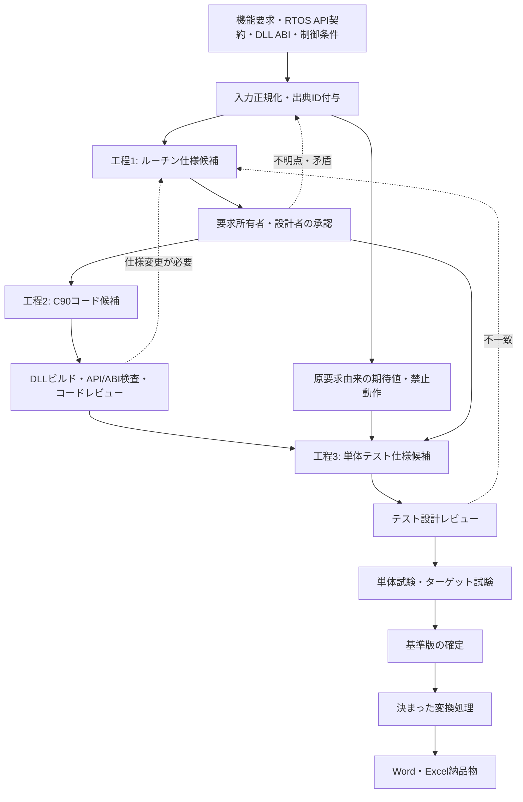

# AIエージェントによる仕様・実装・単体テスト仕様作成：実現可能性と導入計画

## 1. 結論と適用範囲

提案は実現可能である。推奨するのは、**機械可読な仕様正本をGitで管理し、承認を挟む3工程のワークフローでAIを利用し、Word／Excelは正本から再生成する構成**である。

対象は、**既存のWindows 10上のRTOS実行基盤へ、新しい装置制御等を追加するC90 DLL**である。ファイル操作・CPUロック・基板レジスタを通じた低水準I/O等は、必ず基盤の提供関数を利用する。提供関数と実行速度の制約からC90を標準とする、という利用者の条件を前提にした。

AIは開発用端末・CIで仕様とコードの候補を作成する。実行基盤の再選定を主目的にはせず、既存SDK・ABI・提供API・時間予算への適合を自動検査する。制御実行時には、従来のコンパイラで生成したDLLを使う。モデルや文書生成ツールを制御周期内に置く必要はない。

| 対象工程 | 実現可能性の判断 | 成立条件 |
|---|---|---|
| 機能要求 → ルーチン単位プログラム仕様 | 条件付きで実現可能 | ルーチン分割、状態、時間制約、I/O、安全要求、共通設計を入力し、不明点を人が確定する |
| 承認済みプログラム仕様 → C90 DLL | 範囲を限定して導入可能 | 実コンパイラ・SDK・既存規約でビルドし、ABI・提供API制約・依存関係・時間予算を検査する |
| 仕様＋コード → 単体テスト仕様 | 実現可能。ただし期待値の独立性が重要 | 原要求から決める期待値と、コードから補う分岐・例外観点を分離する |
| JSON等 → Word／Excel | 技術的に実現可能 | スキーマ、項目対応、テンプレート、変換器、内容検査・印刷確認を用意する |
| ハードリアルタイム性・機械安全の保証 | AI生成だけでは判定できない | 実行基盤、危険源、時間予算、適用規格に応じた設計・解析・試験・承認が必要 |

この表の評価は資料調査からの判断であり、対象システムでの成功率や工数削減率の実測結果ではない。まず非安全系の判定・変換・診断処理でPoCを行い、制御に近い領域へ段階的に広げる。

## 2. Windows 10・C90で先に確定すべき条件

### 2.1 既存RTOS基盤と追加DLLの境界

実行基盤の存在は確定している。未確定なのは製品・独自基盤の識別、SDK版、提供APIの正確な契約、DLLのロード・呼出し契約である。一般的なWindowsプログラムとしてコード生成するのでなく、**この基盤向けの開発プロファイルを先に作る**。

| 領域 | 実装上の前提 | 導入計画への反映 |
|---|---|---|
| ファイル操作 | RTOS提供関数を利用 | 呼出し可能な文脈、ブロッキング・完了・失敗の意味を登録する |
| CPUロック | RTOS提供関数を利用 | 保護対象、ネスト、解除・状態復元、保持上限を登録する |
| 基板レジスタI/O | RTOS提供関数を利用 | 許可アドレス・幅・値・順序・副作用を登録する |
| DLLの公開関数・コールバック | 既存基盤の契約に一致 | ABI、初期化・開始・停止・終了、並行呼出しを固定する |
| 時間保証 | 既存基盤が定める実行条件に従う | DLL自身・API待機・ロック・I/Oを含む時間予算を検証する |

SDKや既存実装にない関数・動作をAIに推測させない。基盤が禁止する処理を、Win32 API、CRT、直接メモリマップ、別ライブラリで代替する実装も不適合とする。ただし、標準C関数を一律に禁止するのでなく、既存基盤の規則に基づいて許可・禁止範囲を定義する。

初週に確認する情報は次のとおり。

- Windowsのエディション・ビルド、CPU、32／64bit、既存RTOS基盤・SDKの版、I/O装置・ドライバ・通信方式。
- コンパイラ・リンカ・最適化設定、C90に加えて認めるベンダー拡張、既存DLLのソース・ビルド・ロード試験手順。
- 提供APIの仕様書・ヘッダ・ライブラリ、許可／禁止API、レジスタ仕様と装置リビジョン、実行時間の根拠。
- 制御周期、締切、許容ジッタ、入力から出力までの許容遅延、逸脱時の動作。
- スレッド／割込み／コールバック、共有資源、優先順位、再入可能性、I/O所有者。
- 危険源、安全機能の担当、安全状態、停止・保持・復帰条件、既存の安全審査手順。

Windows 10の一般的なサポート終了日は2025年10月14日だが、LTSCやESU等は別条件である。対象機の正確な製品ライフサイクルと保守契約を確認する。AI基盤は制御機とは別端末に置けるため、導入に際して制御機のOS更新を必須とはしない。[Microsoft WindowsライフサイクルFAQ](https://learn.microsoft.com/en-us/lifecycle/faq/windows)

### 2.2 C90はプロンプトではなく検査条件にする

MSVCの既定Cモードは拡張を含むANSI C89で、厳密なC89適合モードを指定できないと公式に説明されている。既存MSVCでビルドできることと、C90制約を守ることは別に検査する。[MicrosoftのC標準対応](https://learn.microsoft.com/en-us/cpp/build/reference/std-specify-language-standard-version?view=msvc-170)

推奨する検査構成は、実コンパイラによる正式ビルドと、移植可能な制御ロジックに対する補助的な規格検査の併用である。GCCを利用できる場合の候補は`-std=c90 -pedantic-errors`。ただしWindows／RT拡張ヘッダを含むコード全体へ無条件に適用せず、HAL境界で分ける。補助コンパイラの合格は実環境のABI・タイミング適合を保証しない。[GCCの標準対応](https://gcc.gnu.org/onlinedocs/gcc/Standards.html)

生成規約には、C99以降の構文・標準ライブラリの混入防止、型幅と符号、オーバーフロー、ポインタ・配列範囲、初期化、エラー戻り値を含める。動的メモリ、再帰、無制限ループ、ブロッキングI/O、ログ出力、ロック保持時間は、制御周期内での使用可否を明示する。`volatile`だけでスレッド同期が成立すると扱わず、採用実行基盤の同期規則を指定する。

### 2.3 提供API契約カタログをAIの必須入力にする

提供APIごとに安定したAPI-IDを付け、SDK・原資料の版と対応させた機械可読カタログを作る。仕様書・コード・テストの全工程が同じ契約を参照する。

| 契約項目 | 記録する内容 |
|---|---|
| 宣言と呼出し条件 | 正式な宣言、ヘッダ、リンク先、引数・戻り値・エラー、呼出し可能なタスク／割込み／初期化文脈 |
| 実行特性 | 同期／非同期、ブロッキング・タイムアウト、再入、コールバック、処理時間の保証・実測・未確認の区別 |
| 資源の契約 | ハンドル・バッファ所有権、有効期間、解放方法、異常時の状態、呼出し順序 |
| CPUロック | 対象CPU・割込み・スケジューラ・共有資源のどれを保護するか、ネスト、元状態の復元、保持上限、保持中の禁止処理 |
| レジスタI/O | アドレス範囲、アクセス幅・アラインメント、バイト順、読出し副作用、write-one-to-clear、予約ビット、read-modify-write可否、順序・バリア |

CPUロックを多コア共有資源の排他と同義には扱わない。全終了経路で解除・状態復元が必要かを契約どおり検査する。I/Oの追加読出しが副作用を起こす可能性もあるので、デバッグ用の読出しや無制限ポーリングをAIが追加しないよう制約に含める。上記項目の意味・値は実SDKと装置資料から確定する。

### 2.4 DLLのABI・ライフサイクル・依存関係を固定する

DLL単位の契約として、CPU／ビット数、コンパイラ・リンカ、公開シンボル、呼出し規約、コールバック型、型幅、構造体配置・アラインメント、エクスポート方式、メモリ所有権、基盤の対応版を固定する。C90にない宣言がSDKに必要なら、許可するベンダー拡張として明示する。

初期化途中の失敗、開始前の出力、停止・取消し、実行中コールバックの終了待ち、資源解放、アンロード、再ロードを状態として仕様化する。RTOSの初期化・終了コールバックとWindowsの`DllMain`を混同しない。Windowsローダーで`DllMain`が実行される構成なら、ローダーロック下の呼出し制限も確認する。[Microsoft DLL Best Practices](https://learn.microsoft.com/en-us/windows/win32/dlls/dynamic-link-library-best-practices)

ソース検査に加え、最終DLLの公開関数、インポート、依存ライブラリ、リンクマップを確認する。MSVC製PE形式DLLならDUMPBIN等を利用できる。静的リンクや関数ポインタ経由の呼出しはインポート表だけでは把握できないため、呼出し関係・マクロ展開・ライブラリ内部も対象にする。コンパイラ生成のCRT補助関数を含め、許容依存は基盤の契約で決める。[DUMPBIN options](https://learn.microsoft.com/en-us/cpp/build/reference/dumpbin-options?view=msvc-170)、[/IMPORTS](https://learn.microsoft.com/en-us/cpp/build/reference/imports-dumpbin?view=msvc-170)

## 3. 構成案の比較と推奨

以下は本調査での提案であり、利用者が選定済みの方式ではない。

| 方式 | 利点 | 制約・適する用途 |
|---|---|---|
| A. 工程ごとにチャットで作成し、Officeへ直接出力 | 小さく試せる | 正本・承認・再実行・変更影響を揃えにくい。単発の比較試験向け |
| **B. Git正本＋固定工程＋承認＋決まった変換処理** | 追跡性を確保しやすく、既存ビルドやCIと接続できる | スキーマ・検査・変換器は開発が必要。初期導入の推奨方式 |
| C. 永続化された複数エージェント基盤＋検索基盤 | 多案件・長時間処理・多数の担当者へ拡張しやすい | 状態管理・権限・運用が増える。Bの実測後に必要部分を採用 |

PoCはBを採用候補とし、既存Git／CIと小さな実行制御プログラムから始める。「設計・実装・テスト設計」の3役割は必要だが、3つの常駐サービスや別々のモデルである必要はない。まずは同じモデルでも呼出し・入力・権限・出力契約を分ける。

長期間の承認待ちや多数の並列処理が必要になれば、LangGraph等のチェックポイント・中断／再開を比較する。再開時に処理が再実行される場合を想定し、ファイル出力・記録には重複防止を設ける。[LangGraph Persistence](https://docs.langchain.com/oss/python/langgraph/persistence)、[Interrupts](https://docs.langchain.com/oss/python/langgraph/interrupts)



HIL・実機による時間・装置挙動の確認は、単体試験の後に別の合格判定として設ける。文書のプレビューは各工程でも生成できるが、正式納品版は確定した基準版から生成する。

## 4. 3工程の入出力と責任分担

| 工程 | 必須入力 | AIの出力 | 自動検査 | 人の確認・差戻し条件 |
|---|---|---|---|---|
| 入力整備 | 機能要求、既存DLL、SDK・API契約、ABI、レジスタ・データ定義、規約、制御条件 | 要求一覧、出典、用語、曖昧点、設計前提候補 | ID重複、参照、抽出漏れ候補 | 図表・注記を含む抽出の妥当性。未定のAPI・安全・時間条件は勝手に補わない |
| 1. 仕様作成 | 承認済み要求と共通設計・基盤契約 | ルーチン仕様、API呼出し手順、状態遷移、ロック範囲、入出力、追跡リンク | スキーマ、参照整合、必須欄、文脈別のAPI利用可否 | 要求所有者＋制御設計者。要求欠落、矛盾、未決事項があれば実装へ進めない |
| 2. コード作成 | 承認仕様の版、既存コード、正式ヘッダ・ライブラリ、DLL ABI、実ビルド条件 | 差分コード、仕様ID対応、DLLとビルド結果、制約違反候補 | 正式ビルド、補助C90検査、静的解析、API利用・エクスポート・依存関係 | C設計者＋制御担当。仕様を変えなければ直せない場合は工程1へ戻す |
| 3. テスト仕様作成 | 原要求、承認仕様、コードの確定候補版、独立期待値 | テストケース、条件、操作、期待値根拠、網羅表、未決事項 | 要求・仕様・テストID整合、値・単位・ケース形式 | QA＋制御担当。実装追認、期待値未決、観点欠落があれば差戻す |

機能要求だけからルーチンの境界や同期方式まで一意には決まらない。共通の状態モデル、提供API契約、DLL ABI、データ型、実行周期、異常処理方針を先に用意する。要求とルーチンは多対多で管理し、1要求＝1関数に固定しない。

単体テスト仕様の作成が依頼された第3工程である。PoCでは、その有効性を評価するために一部を実行可能なCテストへ展開し、意図的な不具合を検出できるか確認する。この実行試験は導入評価の追加作業として計上する。

## 5. 管理正本・追跡・変更管理

### 5.1 正本形式の選定

| 形式 | 向く内容 | 留意点 |
|---|---|---|
| **JSON＋JSON Schema** | 入出力、条件表、状態遷移、ケース、ID参照 | 厳密な検査と変換に向く。長文編集はレビュー表示で補助する |
| YAMLフロントマター付きMarkdown | 説明文中心の設計書 | 本文の見出し・表にも構造規約とパーサが必要。前置メタデータだけでは処理条件を機械検証できない |

PoCでは、**1ルーチンにつき1つのJSON、テストケースは別JSON**を推奨する。人の確認用MarkdownとWord／Excelは生成物にする。長文説明を別MDへ切り出す場合も、同じ項目をJSONとMDで二重に手修正しない。

JSON Schemaは必須項目・型・列挙値等の検査に使える。`properties`だけでは必須化も未知項目禁止もされないため、`required`や`additionalProperties`等を明示する。業務上の正しさ、参照先の存在、時間予算の整合は別の検査が必要である。[JSON Schema仕様](https://json-schema.org/draft/2020-12)、[objectの公式解説](https://json-schema.org/understanding-json-schema/reference/object)

モデルAPIの構造化出力はスキーマに沿う形式生成に利用できるが、意味の正しさは保証しない。例えばOpenAIのStructured Outputsにも対応スキーマの制限と、拒否・未完了応答への処理がある。採用APIに合わせた出力契約と、保存前の独立検証を設ける。[OpenAI公式 Structured Outputs](https://developers.openai.com/api/docs/guides/structured-outputs)

### 5.2 必須の管理情報

- 安定ID：要求`REQ-*`、ルーチン`RTN-*`、テスト`UT-*`。名称変更でもIDは維持する。
- 出典：原本の版・ハッシュ、章節、表／セル／段落等の位置。PDF・スキャンならページと抽出結果を保持する。
- 関係：要求→仕様項目→コードのシンボル→テストケース→実行証跡。行番号だけに依存しない。
- 状態：draft／in_review／approved／stale／rejected等。承認者と対象ハッシュは人のレビュー・ワークフローが記録し、AIには承認権限を与えない。
- 生成履歴：入力の版、SDK・APIカタログ・DLL契約の版、モデル識別子、プロンプト・規約・スキーマの版、使用ツール、出力ハッシュ、費用、再試行・検査結果。
- 納品対応：正本コミット、ソースツリーの識別情報、テスト結果ID、テンプレート版、変換器版、納品物のハッシュ。

コード・仕様・テスト・承認証跡の循環参照を避けるため、納品用manifestを最後に作り、それぞれの対象コミット／ハッシュを束ねる。

想定リポジトリ構成（今後作成する案）は次のとおり。

```text
requirements/             要求の正規化データ・原本参照
runtime/                  SDKプロファイル・API契約・DLL ABI・レジスタ資料参照
specs/routines/           ルーチン仕様JSON
specs/unit-tests/         テスト仕様JSON
schemas/                 要求・仕様・テストのスキーマ
policies/                C90規約、制御・I/O・安全上の制約
src/                     C90 DLLコード・正式な基盤API境界
tests/                   単体テスト・APIモック・DLL結合試験
templates/               Word／Excelテンプレートと項目対応
tools/                   検証・変換・工程実行処理
evidence/                実行結果への参照・納品manifest
dist/                    再生成可能な確認・納品物
```

機密原本や大きな計測ログは、保管先の権限・保持方針に従い、Gitにはハッシュと参照だけを置く運用も可能。Officeテンプレート自体はバイナリなので版を固定し、変更時はプレビュー差分でレビューする。

### 5.3 正本変更と納品後修正

要求・仕様・コードが変わったら依存先を逆引きし、下流を`stale`にする。独立したルーチンは並列処理できるが、共有ヘッダ・状態定義・同じCファイルへの変更は統合担当に集約する。影響がないという判断にも根拠を残す。

Word／Excelで修正依頼を受けた場合は、ID付きコメントまたは差分票を正本へ反映して再生成する。初期導入では自由編集したOfficeファイルとの自動往復同期を対象にしない。テストの実測値・実施者・実施日をExcelへ記入する運用が必要なら、結果入力用の範囲と取込契約を別に定め、仕様欄の上書きを許さない。

## 6. 基本テンプレートの設計

ここでは項目と書式方針を定義する。実際の`.docx`／`.xlsx`テンプレート作成と印刷確認はPoC第2週の成果物とする。

### 6.1 プログラム仕様書：Wordを第一候補

1ルーチンを論理単位にし、納品時にはモジュールごとの1文書へまとめられるようにする。1ルーチンを無理に1ページへ収めない。

| 章・表 | 必須項目 |
|---|---|
| 文書管理 | 文書ID、名称、版、対象モジュール、正本コミット、テンプレート版、承認情報 |
| 目的と追跡 | ルーチンID、責務、関連要求ID、出典、設計判断、適用外事項 |
| 呼出し契約 | 関数名・Cプロトタイプ、呼出し元、周期／イベント、実行スレッド・割込み文脈 |
| 基盤・DLL契約 | SDK・API契約ID、DLL ABI参照、公開／内部関数の区別、コールバック、許可文脈 |
| 入出力 | 型・幅・符号、単位、許容範囲、欠損・無効値、ポインタの所有権、戻り値 |
| 処理 | 前提／事後条件、判定表、状態遷移、処理手順、優先順位、不変条件 |
| 状態と資源 | 静的／共有変数、初期化・リセット、再入可否、排他、依存先、I/O副作用 |
| 提供APIの利用 | 呼出し順序・引数・戻り値処理、CPUロックと解除・状態復元、レジスタ副作用、API失敗時の後始末 |
| 異常・安全 | 異常検出、タイムアウト、インターロック、要求で定義した安全状態、保持・復帰条件 |
| 時間と容量 | 周期T、締切D、許容ジッタJ、処理時間予算、最大反復回数、スタック・バッファ上限 |
| 検証情報 | 対応テスト、レビュー指摘、未決事項、前提・制約 |

書式案：A4、見出し階層、文書ID・版入りヘッダ、ページ番号、表見出しの繰返し、日本語フォント固定。状態図は必要時のみ追加し、状態・遷移の意味は表データにも保持する。

### 6.2 単体テスト仕様書：Excelを第一候補

| シート | 内容 |
|---|---|
| 文書管理 | 文書ID、対象版、環境、正本コミット、承認、凡例 |
| テストケース | テストID、要求ID、ルーチンID、観点、初期状態、入力系列、モック、操作、期待値、根拠、優先度 |
| 時間・異常系列 | 入力の時刻、周期数、故障注入、タイムアウト、許容応答時間、禁止出力、復帰条件 |
| API・DLL契約試験 | API呼出し順序・引数・回数、禁止呼出し、ロック対応、初期化失敗、停止・再ロード、ABI・依存関係 |
| トレーサビリティ | 要求・仕様項目・コード・テストの対応、対象外の理由 |
| 実施結果 | 実行ID、対象バイナリのハッシュ、実環境、実測値、合否、ログ参照、実施者・日付 |
| 未決・除外事項 | 未定の期待値、実施不能条件、手動確認、除外の承認 |

書式案：ケース表は1行1ケース、詳細な時系列は別表でケースIDと結ぶ。フィルタ・先頭行固定・折返し・印刷タイトルを設定し、ケース表内の結合セルは避ける。入力値・時間・単位を列で分け、IDは文字列として保持する。長文の切れ、横幅、印刷倍率を確認する。

合否や実施日は生成AIが埋めない。実行前は「未実施」とし、自動結果または実施者の記録から更新する。仕様と実績は別データで保持する。

### 6.3 正本データのイメージ

以下は構造を説明する架空の例であり、実装用の完成仕様ではない。実際の安全機能・条件・数値を示すものではない。未定値は隠さず、工程の進行条件で検出する。

```json
{
  "schema_version": "0.1",
  "routine_id": "RTN-DEMO-001",
  "name": "evaluate_start_permission",
  "requirement_ids": ["REQ-DEMO-001"],
  "source_refs": [
    {"document_id": "FRS-DEMO", "revision": "draft-1", "locator": "section:3.2"}
  ],
  "language": "C90",
  "runtime_profile_id": "RTOS-PROFILE-DEMO",
  "dll_contract_id": "DLL-CONTRACT-DEMO",
  "api_contract_ids": [],
  "execution_context": null,
  "contract": {
    "prototype": "int evaluate_start_permission(int ready, int request);",
    "inputs": [
      {"name": "ready", "c_type": "int", "allowed_values": [0, 1]},
      {"name": "request", "c_type": "int", "allowed_values": [0, 1]}
    ],
    "return_values": [0, 1],
    "side_effects": []
  },
  "timing": {"period_us": null, "deadline_us": null, "budget_us": null},
  "safety_requirements": [],
  "open_questions": [
    {"id": "Q-DEMO-001", "text": "呼出し周期・時間予算を確定する"},
    {"id": "Q-DEMO-002", "text": "全判定条件・無効入力時の動作・安全要求との関係を確定する"}
  ]
}
```

この例はI/O副作用のない内部判定関数であり、API参照を空にしている。APIを使うルーチンには正式なAPI-IDと呼出し手順を必須にする。承認状態は入れていない。承認対象ハッシュと承認者は別の記録にする。本番スキーマではdraft時の未定値と、実装可能な承認仕様の必須条件を区別する。

## 7. OfficeCLIの適性と代替技術

### 7.1 調査時点で確認できたこと

公式リポジトリの調査対象は、版`1.0.161`、コミット`91c06b6f5c80e3f33d957ff0426672f558efa25e`。Release公開日時は2026年11月12日09:51:03 UTC。以後の評価もこの版などの固定版で行い、自動追随しない。[対象コミット](https://github.com/iOfficeAI/OfficeCLI/commit/91c06b6f5c80e3f33d957ff0426672f558efa25e)、[Release](https://github.com/iOfficeAI/OfficeCLI/releases/tag/v1.0.161)

| 確認項目 | 調査結果と判断 |
|---|---|
| Word／Excel操作 | `.docx`／`.xlsx`の作成・読取・更新、JSON形式の操作に対応。候補にできる |
| データ差込み | `merge`でJSONデータとプレースホルダを利用できる。業務スキーマからの変換層は別途必要 |
| 複数操作・既存様式 | `batch`、`dump`を利用できる。可変表の組立や様式維持は対象テンプレートで試す |
| 検証 | `validate`はOpenXMLの構造検証。要求の正しさ・期待値・印刷品質の保証とは別 |
| 配布・依存 | `.NET 10`のself-contained単一配布物。文書生成用環境へ配置し、制御プログラムの依存にはしない |
| ライセンス | 本体はApache-2.0。配布形態に応じて第三者依存の通知も確認する |

根拠：[固定版README](https://github.com/iOfficeAI/OfficeCLI/blob/91c06b6f5c80e3f33d957ff0426672f558efa25e/README.md)、[プロジェクト定義](https://github.com/iOfficeAI/OfficeCLI/blob/91c06b6f5c80e3f33d957ff0426672f558efa25e/src/officecli/officecli.csproj)、[LICENSE](https://github.com/iOfficeAI/OfficeCLI/blob/91c06b6f5c80e3f33d957ff0426672f558efa25e/LICENSE)

ソースから、次の留意点を確認した。

- Wordの`merge`は個々の`w:t`要素内で置換する。装飾等でタグが複数の要素へ分かれた場合は未置換になる可能性がある。
- Excelの`merge`は差込み結果を`InlineString`として書く。数値・日付・数式として扱う列は、型付きのセル更新処理を別に選ぶ。
- PNG取得は外部ブラウザ等を利用する。HTMLプレビューと納品先Word／Excelのページ割りが一致するとは限らない。

これらは固定版のソースを読んだ結果であり、実行による再現試験は未実施。[TemplateMerger.cs](https://github.com/iOfficeAI/OfficeCLI/blob/91c06b6f5c80e3f33d957ff0426672f558efa25e/src/officecli/Core/TemplateMerger.cs)、[HtmlScreenshot.cs](https://github.com/iOfficeAI/OfficeCLI/blob/91c06b6f5c80e3f33d957ff0426672f558efa25e/src/officecli/Core/HtmlScreenshot.cs)

### 7.2 比較対象と採用方針

| 技術 | 主な用途・選定理由 | 確認点 |
|---|---|---|
| OfficeCLI | Word／Excelを共通CLIとJSON操作で扱いたい | 上記の差込み・型・可変表・表示互換性 |
| docxtpl | 既定Word様式に条件分岐・繰返しを含めて差し込む | タグ配置、表、改ページ、日本語表示 |
| python-docx | Wordの文書要素をコードで組み立てる | 既存様式を維持するための実装量 |
| openpyxl | Excelの型・セル・書式・表を制御する | 数式の評価は行わない。複雑な既存部品の保持は実物で確認 |
| Pandoc | 説明文中心のMarkdownをWordへ変換する | `reference-doc`は本文の差込み帳票ではなく、スタイル等の参照として使う |

公式資料：[docxtpl](https://docxtpl.readthedocs.io/en/latest/)、[python-docx](https://python-docx.readthedocs.io/en/latest/)、[openpyxl](https://openpyxl.readthedocs.io/en/stable/)、[数式に関する制約](https://openpyxl.readthedocs.io/en/stable/simple_formulae.html)、[Pandoc reference-doc](https://pandoc.org/MANUAL.html#option--reference-doc)

**採用提案：**変換器のインターフェースを共通化し、OfficeCLIと「Wordはdocxtpl、Excelはopenpyxl」を同じデータ・様式で比較する。実装量・内容一致・印刷品質・保守性で選び、OfficeCLIの採用自体をプロジェクトの成功条件にしない。制御コードがC90でも、開発支援・文書変換をPython等で実装することに支障はない。

## 8. 品質保証：実装を追認するテストを避ける

最大の問題は、誤った仕様とコードを読んだAIが、それに一致する誤った期待値を作ることである。別エージェントに分けるだけでは、この誤りの独立性を保証できない。

例えば原要求が「100以上を許可」で、コードが`> 100`なら、コードから作った期待値では境界100を見逃し得る。制御系では同じことが、異常時の出力、停止条件、復帰条件、時間判定にも起きる。

次の二段階で第3工程の入力を作る。

1. **原要求から観点と期待値を用意する。** コードを見せず、要求・承認済み設計から、正常／境界／無効入力／状態遷移／禁止出力／時間条件を抽出し、人が期待値を確定する。これは実装前にも準備できる。
2. **コードを見て不足観点を加える。** 分岐、依存先の異常、資源制約等を補う。実装由来の観点には印を付け、原要求との不一致を差戻す。

単体テスト仕様確定時は両者を統合する。コードの実行値をそのまま正解にしない。曖昧な期待値は未決として止める。NIST SSDFも設計判断、コード解析・レビュー、テスト設計・結果の記録を扱っており、既存の開発統制へAI生成物を組み込む根拠にできる。[NIST SP 800-218](https://nvlpubs.nist.gov/nistpubs/specialpublications/nist.sp.800-218.pdf)

### 8.1 機械制御で追加する観点

- 起動、初期化、通常運転、停止、異常保持、リセット、復帰の状態遷移と禁止遷移。
- 同時イベントの優先順位、インターロック、通信断、タイムアウト、ウォッチドッグ失効。
- センサ断線・固着・範囲外・値の陳腐化、チャタリング、単位・スケーリング、整数境界。
- 共有データの整合、再入、ロック・優先順位、周期逸脱、時刻カウンタの周回。
- 提供APIの失敗・タイムアウト・部分完了、必要な呼出し順序、CPUロックの全経路での解除・状態復元、保持中の禁止処理。
- レジスタのアクセス幅、予約ビット保持、読出し副作用、write-one-to-clear、有限ポーリング、装置リビジョン差。
- DLLの初期化失敗、開始前の出力、停止中の呼出し、コールバック実行中のアンロード防止、再初期化・再ロード。
- 安全状態、停止時間、停止後の出力、復帰の許可条件。全出力OFFが常に安全とは仮定しない。

非常停止等が別の安全制御器の責務なら、その責務分担とインターフェースを確認する。対象の危険源・安全要求が未確定なので、本計画だけでIEC 61508／IEC 62061／ISO 13849等への適合や必要SIL／PLの達成を主張しない。

### 8.2 検証環境を区別する

| 段階 | 確認するもの | この段階だけでは確認できないもの |
|---|---|---|
| 仕様・静的検査 | 契約、状態、C90規約、未定義動作候補、範囲・資源制約 | 装置上の実時間・物理挙動 |
| ホストSIL | RTOS API境界・時刻をモック化した制御ロジック、呼出し履歴・境界・異常系列 | 実APIの意味、レジスタ副作用、実SDK・ドライバ・ターゲット時間 |
| ターゲット上のDLL結合・模擬I/O試験 | 正式DLLのロード・呼出し・停止・解放、ABI、コールバック文脈、実RTOS APIとの整合 | 実プラントの全挙動 |
| HIL | 実制御器＋模擬プラントでI/O、遅延、故障応答 | 実装置の全荷重・環境条件 |
| 実機 | 実センサ・アクチュエータ、荷重等を含む動作 | 未試験の全条件に対する数学的保証 |

SILはSoftware-in-the-Loop、HILはHardware-in-the-Loopを指す。上記の試験段階の呼称と責務はプロジェクト内で統一する。

Cの単体テストにはUnity、必要に応じてCMock・Ceedlingを候補にする。UnityはANSI Cで提供され、Ceedlingはnative／emulator／on-targetの実行環境を扱う。既存コンパイラ・SDKとの適合は別途確認する。[Unity公式](https://www.throwtheswitch.org/unity)、[Ceedlingの実行環境](https://docs.throwtheswitch.org/Ceedling/latest/overview/test-environments/)

周期T、締切D、許容ジッタJ、応答遅延は別項目にする。時間予算には、関数自身の処理だけでなく、提供APIの処理・待機、CPUロック保持と競合、コールバック、I/O完了を含める。APIの保証が不明ならAIに数値を補完させず、基盤担当へ確認する。

実測値にはCPU／BIOS、OS・RTOS・SDK版、他DLLを含む負荷、割込み、I/O、最適化、測定方法・測定負荷を付ける。**最大観測実行時間をWCETの証明と呼ばない。** 必要な最悪時間保証の方法は既存基盤の保証条件と要求に合わせて選ぶ。

カバレッジは要求・状態遷移・分岐を評価し、ホストとターゲットを分けて報告する。gcov等の計測ビルドと本番の最適化済みバイナリは区別する。高い行カバレッジだけで期待値の正しさを判定しない。[GCC gcovと最適化](https://gcc.gnu.org/onlinedocs/gcc/Gcov-and-Optimization.html)

## 9. 必要技術と初期の最小構成

| 領域 | PoCで必要なもの | 拡張を判断する条件 |
|---|---|---|
| 入力抽出 | docx／xlsx／PDFの抽出、図表確認、出典保持 | スキャン原本が多ければOCR・画像読取を追加 |
| 知識入力 | 対象要求、SDK・提供API・DLL ABI・レジスタ定義、規約をIDで選択 | 資料量が増えたら全文検索／RAG。出典版を常に保持 |
| モデル接続 | コード理解・構造化出力に対応する承認済みモデル、API接続層 | 同じ評価セットで複数候補を比較。モデル名・価格だけでは選ばない |
| 工程制御 | 固定3工程、承認状態、再試行上限、費用上限、保存・再開 | 長時間・多案件運用なら永続化基盤へ移す |
| 正本管理 | Git、JSON Schema、参照・意味制約検査、レビュー表示 | データが増えても安定IDと版の契約を維持 |
| C開発 | 正式DLLビルド、静的解析、補助C90検査、提供API・公開関数・依存関係の検査 | 基盤SDKの更新や既存DLLの大規模改修は別見積もり |
| テスト | 既存基盤またはUnity等、RTOS APIモック・仮想時刻、DLLロード試験、結果保存 | ターゲット・HIL・実機の自動化は段階導入 |
| 文書変換 | テンプレート2種、変換器、内容比較、表示・印刷確認 | 大量文書に合わせて性能・互換性を追加検証 |
| 証跡・運用 | 実行manifest、入力／出力ハッシュ、ログ、権限、秘密情報管理 | 保持期間・監査要件に合わせた保存先 |

初期には、専用Web画面、ベクトルDB、学習用の大量データ、モデルの追加学習は必須ではない。Gitレビューと既存CIで不足する点を測定してから追加する。

機密仕様・コードを外部APIへ送る可否、保存・学習利用・地域・削除条件は採用サービスの契約で確認する。外部送信できない場合は承認済み閉域基盤・ローカルモデル等を別候補とし、同じ評価セットで品質と運用費を測る。

入力文書・既存コメントはデータとして扱い、そこに記載された実行命令をエージェントの権限へ昇格させない。生成コードは隔離した試験環境で実行し、制御ネットワーク・本番I/Oへのアクセスは付与しない。外部コンテンツからの指示混入はRAGだけでは防げない。[OWASP Prompt Injection](https://genai.owasp.org/llmrisk/llm01-prompt-injection/)

## 10. PoCの実行計画

### 10.1 対象と前提

まず既存RTOS基盤・SDK・C90ツールチェーンを固定し、追加DLL 1本、1系統の装置構成、3〜5機能・12〜20ルーチン程度を対象とする。これは初期の比較対象数の提案であり、全制御領域への統計的な一般化を保証する標本数ではない。

利用者が提示した具体例を、PoCの代表要求に採用する案とする。最初に「PLC信号の10周期連続ONによるアラーム・画面公開・ログ予約」で3工程と文書展開を一貫して確認し、次に「第2段移動平均からガウス関数型フィルタへの条件付き変更」で既存互換・数値精度・遅延・切替を評価する。要求の分割、未決事項、ルーチン候補、テスト例は[具体例に基づく追補](2026-11-13-ai-agent-control-requirement-examples.md)にまとめた。これらの未決事項が確定するまでは、実装用の承認仕様として扱わない。

対象には、純粋な判定・変換、時間判定、状態保持、提供API経由のI/Oを含める。ファイル操作とCPUロックの契約検査も代表ケースに含め、時間制約のある文脈からの禁止呼出しを検出する。初回の自動生成適用は非安全系から始め、安全に関係する条件は机上・SILでレビュー方法を検証する。実機操作や既存の安全機能の置換は別の承認工程にする。

前提は、既存DLLの正式ビルド・ロードが再現可能で、SDK・API・レジスタ資料と過去の要求・仕様・コード・テスト例を利用でき、基盤担当・要求所有者・制御担当がレビューに参加できること。API契約資料の新規整備が大きくなる等、満たさない前提は第1週で補正し、工数を再見積もりする。

### 10.2 8週間のWBS案

工数は新規の支援基盤・比較評価に対する概算で、見積精度は未検証。実装方式確定後に更新する。

| 期間／タスク | 実施内容 | 成果物・完了条件 | 主担当 | 概算人日 |
|---|---|---|---|---:|
| W1 / P0 対象確定・現状測定 | SDK・API・ABI・安全責務・C90条件を確認、対象選定、従来工数と欠陥を測定 | 既存の最小DLLが正式環境でロード・呼出し・停止・解放できる。環境票、API契約案、評価基準が揃う | 制御／RTOS基盤担当＋QA | 5〜8 |
| W2 / P1 正本・テンプレート | 要求／ルーチン／テストとAPI契約のスキーマ、ID、承認契約、Officeテンプレートを作成 | 代表APIの文脈・時間・失敗契約が揃い、手作り正本からWord／Excelの内容・印刷を確認 | AI支援基盤担当＋QA | 8〜12 |
| W3〜4 / P2 工程1・2 | 仕様候補生成、承認後のC90 DLL差分生成、正式ビルド・API／ABI・依存関係検査 | 代表3〜5ルーチンで追跡可能。禁止API・未承認版を検出し、生成DLLを試験環境へロードできる | AI支援基盤担当＋C開発者 | 16〜22 |
| W5〜6 / P3 工程3・試験 | 独立期待値、APIモック、呼出し順・ロック・異常系列、DLL結合試験 | 実装追認・不正API系列・解除漏れを検出。原要求・仕様・DLL・結果の対応が揃う | QA＋制御／RTOS基盤担当 | 16〜22 |
| W7〜8 / P4 比較・運用判定 | 複数回評価、要求・SDK契約変更、失敗・再開、OfficeCLI比較、ターゲット／利用可能なHILで時間・I/O評価 | 指標・制約・再現手順・次段階の採否。未評価の時間・装置条件を明示 | 全担当 | 15〜20 |
| **合計** | **基盤と限定PoC** | **本番装置への無条件適用は含まない** |  | **60〜84** |

実働の目安は主担当エンジニア1名、制御・RTOS基盤リード0.3名、QA0.4名、要求所有者0.2名、CI／運用担当0.1名程度。兼務可能である。表中の「AI支援基盤」と既存RTOS基盤は区別する。HIL・実機予約、調達、ライセンス、閉域環境整備の待ち時間は別枠。新規HIL構築や規格適合活動が必要なら、8週間のPoCとは別計画にする。

### 10.3 実装タスクの契約と確認方法

| タスク | 今後作成する主要ファイル群 | 入出力契約 | 完了の確認方法 |
|---|---|---|---|
| 正規化・出典 | `requirements/`、`schemas/` | 原本＋抽出位置 → 要求ID付きデータ | 図表を含む代表原本で人が抽出対応を照合。欠落・重複・未知参照を検出 |
| RTOS・DLLプロファイル | `runtime/`、`schemas/`、既存ビルド設定 | 正式SDK・提供資料＋既存DLL → API許可表・ABI・ライフサイクル契約 | 最小DLLのビルド・ロード・停止・解放、型・公開関数・呼出し文脈を基盤担当が確認 |
| 正本検査 | `schemas/`、`tools/validate*` | 仕様データ＋関連ID → エラー／警告 | 欠落欄、未定時間、存在しないID、未承認入力の負例で停止を確認 |
| 仕様生成 | `tools/workflow*`、`policies/` | 承認要求＋共通設計＋基盤契約 → draft仕様＋未決一覧 | 原要求の抜け・矛盾・API条件違反・分割ミスを独立評価セットで検出 |
| 実装生成 | `src/`、ビルド設定 | 承認仕様＋正式SDK＋コード基準版 → 差分とDLL | 正式ビルド・C90・API／ABI・依存検査、対象外ファイル改変防止。禁止処理を別名・ライブラリ経由で迂回する負例も検出 |
| テスト設計・実行 | `specs/unit-tests/`、`tests/` | 原要求期待値＋仕様＋コード＋API契約 → ケース＋実行証跡 | 閾値・時間境界、API呼出し順序、ロック復元、レジスタ副作用、DLLライフサイクルの埋込欠陥を検出 |
| 文書展開 | `templates/`、`tools/render*` | 検証済み正本＋テンプレート版 → Office成果物＋manifest | ID・件数・値・単位の照合、未置換0、セル型、改ページ・印刷の確認 |
| 変更・再開 | `tools/workflow*`、CI設定 | 変更差分＋旧manifest → 影響候補と再確認状態 | 変更した要求の下流失効、再開時の重複防止、承認対象差替え防止 |

具体的な支援ツールの関数API、ライブラリ版、ビルドコマンドは、W1で現行ツールチェーンを確認してから実装設計に固定する。制御DLLの提供関数はAIが設計するのでなく、既存SDKの宣言を採用する。

### 10.4 評価実験

- 従来手法とAI支援を、難易度を揃えた機能群で比較する。同じ担当者の学習効果が一方だけを有利にしないよう対象・順序を調整する。
- 正解・要求欠落・境界不具合・不正な状態遷移・古い入力の扱い等の評価セットを生成側から隠す。危険な故障注入はSIL／HILで先に行う。
- 同じ入力・規約で代表ケースを3回程度実行し、ばらつき・再試行・レビュー負担を記録する。モデル更新時にも同じ評価セットを再実行する。
- 要求変更を2〜3種類入れ、影響の見逃しと過剰抽出、古い文書の混入を評価する。
- SDK・提供APIの契約変更を1種類入れ、影響する仕様・コード・テスト・DLLの再確認が起動するか評価する。
- Officeの出力は短い表、可変行、長い日本語、ページまたぎ、先頭ゼロのID、数値・日付・数式を含む代表データで評価する。

### 10.5 指標と移行基準案

数値は着手時に合意する評価基準の案であり、達成見込みを保証するものではない。

| 指標 | 計測方法 | 次段階へ進む基準案 |
|---|---|---|
| 追跡・版の完全性 | 必須ID・出典・承認対象・対象バイナリを検査 | 必須記録100%、未知参照0 |
| 要求充足 | 原要求に対する意味レビュー | 重大な欠落0。安全・時間の必須条件が未決なら進行不可 |
| コード品質・基盤適合 | 正式DLLビルド・解析・公開関数／依存関係・独立レビュー | ビルド・ロード成功、重大指摘未解決0、許可API・ABI・許容拡張に適合 |
| テストの正しさ | 独立期待値照合、埋込欠陥の検出 | 重大な期待値誤り0、対象の重要欠陥を見逃さない。検出力が従来以上 |
| 時間・故障応答 | 合意環境でAPI待機・CPUロック・I/Oを含むターゲット／HILの結果を測定 | 合意した時間・ロック保持上限・禁止出力・復帰条件を満たす。未評価は適用範囲から外す |
| 変更影響 | 既知の変更ケースで影響先を照合 | 重要な影響先の見逃し0。過剰抽出も工数に反映 |
| 納品品質 | 正本との値照合＋Word／Excel確認 | 値・ID・件数の不一致0、未置換0、承認した印刷書式に適合 |
| 生産性 | 作成・レビュー・修正・再生成を含む総実作業時間 | 品質を維持し、従来より総工数が改善。必要な改善幅は業務側が決める |
| 安定性・費用 | 中央値・最大値、失敗・再試行、API・実行費 | 設定した費用・試行上限内。入力と採用結果を追跡できる |

重大な禁止出力、安全停止条件の誤り、提供APIの迂回、CPUロック復元漏れ、機密流出、権限外の実行があればその実行を停止し、原因を分析する。未達の場合は、コード生成を止めて仕様・テスト観点の補助だけにする等、工程ごとに適用範囲を縮小する。

## 11. 費用・効果の算定方法

初期費用は、上記の60〜84人日×社内単価を中心に、API、CI実行、Office／静的解析／RT関連の必要ライセンス、保存容量、試験設備を加算する。新規設備費と安全規格への適合費は別見積もりとする。

```text
月次運用費 = モデル入力・出力の実測利用料
           + 再試行・追加レビュー生成の利用料
           + CI・文書変換・保存費
           + 人の確認・修正・保守工数

実質工数削減 = 従来の作成・確認・修正・納品工数
             - AI導入後の同じ範囲の総工数

回収期間 = 初期導入費 / 月次の純便益
```

モデルの単価は採用時点の見積もりに差し替える。生成時間だけの短縮を効果として計上しない。対象数、複雑度、レビュー難易度別に中央値・最大値も示し、純便益が正になる条件を確認してから本番運用へ投資する。

## 12. PoC後の展開と最初の着手項目

PoC合格後は、同じRTOS・SDK・DLL契約で対象ルーチンを増やし、1案件で既存工程と並行運用する。期待値やレビューを人が確認し、問題がなければ再利用できるAPI契約・規約・テンプレート・評価セットを標準化する。他機種、別SDK、安全に直接関わるコードへ拡大する際は、それぞれの追加評価を行う。

着手順序は次のとおり。

1. 既存RTOSのSDK・提供API・DLL ABI・時間制約・安全責務を環境票と契約カタログにまとめ、既存の最小DLLのビルド・ロードを再現する。
2. 追加DLLに近い既存の機能要求・プログラム仕様・C90コード・単体テスト資料を1組選び、要求所有者・制御担当・基盤担当が期待値とAPI利用条件を確認する。
3. その1組からルーチン仕様・テスト・API参照のデータ契約、Word／Excelの基本様式を定義する。
4. 手作りの正本データで文書変換を試し、OfficeCLIと代替を比較する。
5. 変換・検査が成立した契約に沿って、AIの3工程を組み込み、限定PoCを開始する。

既存RTOS基盤の存在、C90 DLLによる追加機能開発、指定された操作の提供API経由という条件は確定している。未確定なのは製品・SDKの具体名と版、正式コンパイラ・ABI、提供関数の詳細契約・時間上限、安全要求、既存様式、機密情報の取扱条件であり、W1で確認・決定する事項として管理する。
